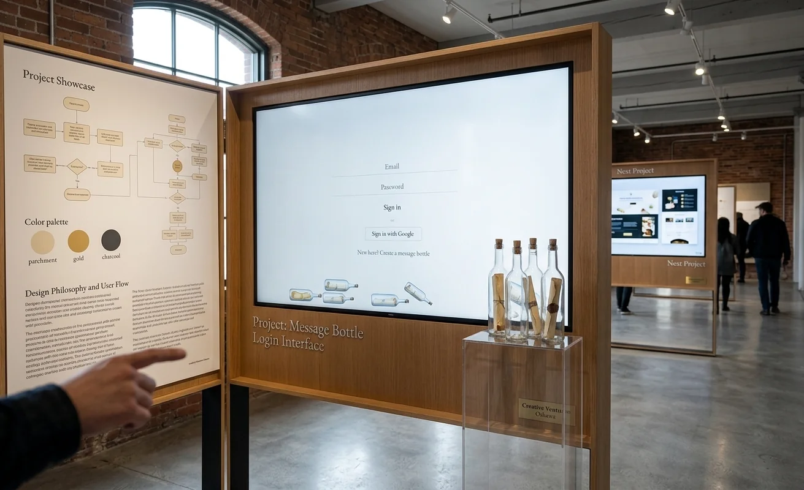

# Msg In A Bottle — type something, watch it fall

A minimalist, physics-based digital diary and messaging app. What you type
breaks apart into individual letters that fall, collide and pile up into a
growing bed beneath you, a quiet place to let a thought go. Send a private
link to a friend and the pile keeps growing together, reply by reply.



## See it

| | |
|---|---|
| **Live app** | **https://www.msg-in-a-bottle.com** |
| Vercel deployment | https://msg-in-a-bottle.vercel.app |

## Who it's for

- **People who want somewhere calm to write things down**: a diary that
  turns typing into something visual and physical instead of another text box.
- **Friends keeping a slow, private back-and-forth**: one shared link per
  conversation, no app to install, and the friend doesn't need an account.

## What it does

- **Falling-letter physics:** each message splits into letters that fall
  under gravity on an HTML5 canvas (Matter.js, no DOM node per letter). The
  pile persists across visits.
- **Bottles:** every bottle is its own unguessable URL. The core loop is
  **receive → read → reply → release**: open a bottle, read the note inside,
  write back, and send it on.
- **Diary bottles:** same physics and visuals, but entries just accumulate,
  with no seal-and-release step, for writing to yourself.
- **Reply notifications:** owners get an email when someone replies. A
  visitor without an account can leave an email for that one bottle to hear
  back too.
- **Accounts:** email/password or Google sign-in, a dashboard with unread
  tracking, and self-service "wipe my data" and account deletion.
- **Operations:** an in-app feedback form (bug / love) and an admin
  dashboard to triage and reply to it.

## Tech stack

- **Next.js 16** (App Router, Turbopack) + **React 19** + **TypeScript**
- **Matter.js** + Canvas 2D for the physics and rendering
- **CSS Modules**: hand-rolled styling, no UI framework
- **PostgreSQL** (Neon) + **Prisma 7**
- **Auth.js (next-auth v5)**: credentials with `bcryptjs` hashing, plus Google OAuth, JWT sessions
- **Resend** for notification emails
- **Vercel** hosting, auto-deployed from `main`

```bash
npm install      # also runs prisma generate
npm run dev
```

Needs a `.env` with `DATABASE_URL`, `AUTH_SECRET`, `AUTH_GOOGLE_ID` /
`AUTH_GOOGLE_SECRET`, and `RESEND_API_KEY` + `EMAIL_FROM` for email.

## Build log & decisions

The session-by-session build log, including production incidents and how they
were fixed, is [`PROGRESS.md`](PROGRESS.md). The full stack breakdown is
[`TECH_STACK.md`](TECH_STACK.md).

## One thing I'd improve

**Rate limiting that holds up in production.** `lib/rateLimit.ts` is a fixed
window kept in memory, per process. On Vercel each serverless instance has its
own memory and is recycled often, so the limit resets and doesn't apply across
instances. Signup, posting a reply, leaving a visitor email, and the
one-email-per-bottle notification throttle are all weaker than they look. Moving the counter to a shared store
(Upstash Redis, or a small Postgres table) would make the limits real without
changing any call sites.
